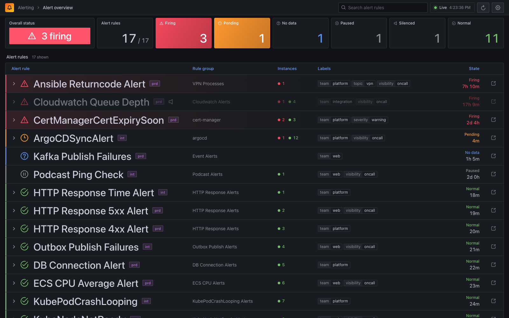
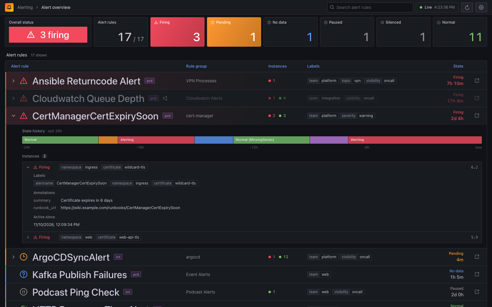
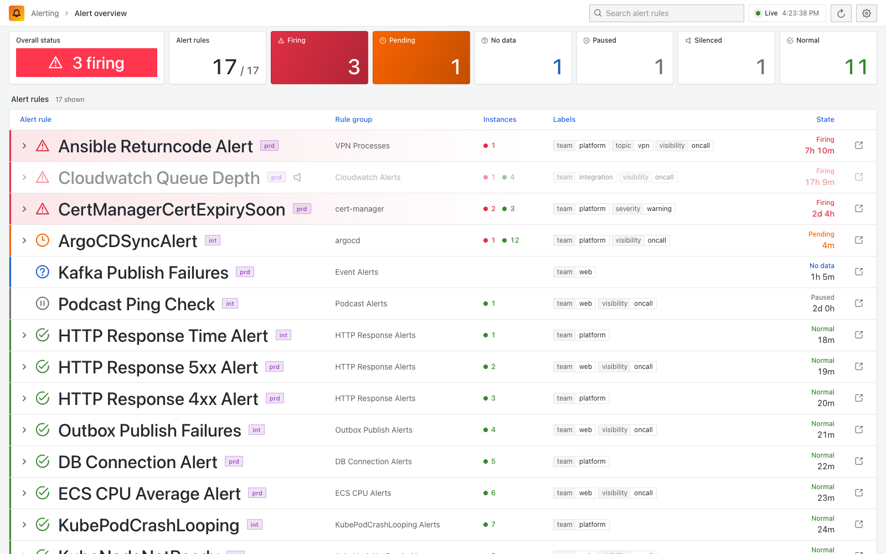
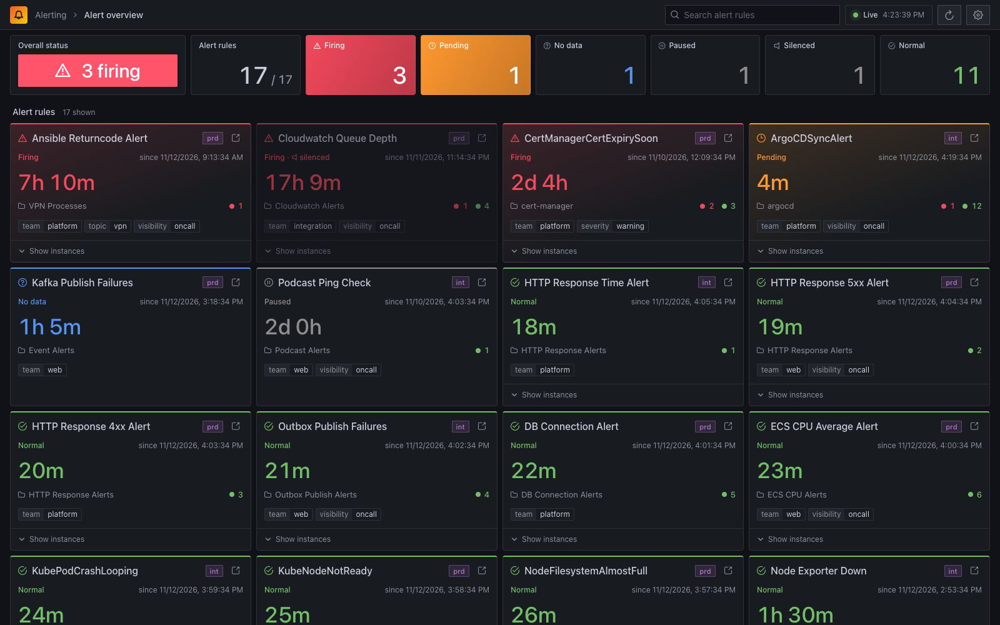
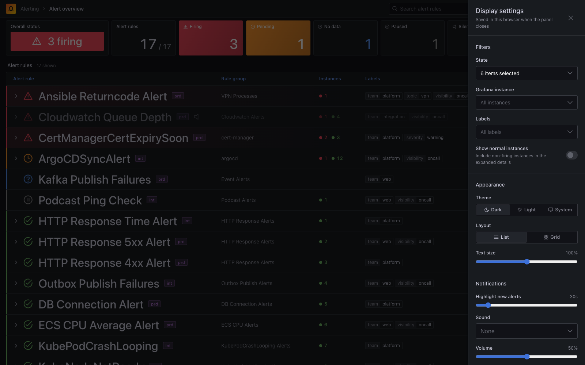

# Screenshots

All screenshots use mock data.

### Dark Theme
The default view: summary stat panels and the alert rule list, styled like our Grafana dashboards.

### Alert Details
Click a rule with instances to see its 24h state history, the firing instances with their labels and annotations, and any silences.

### Light Theme

### Grid View

### Settings

   
